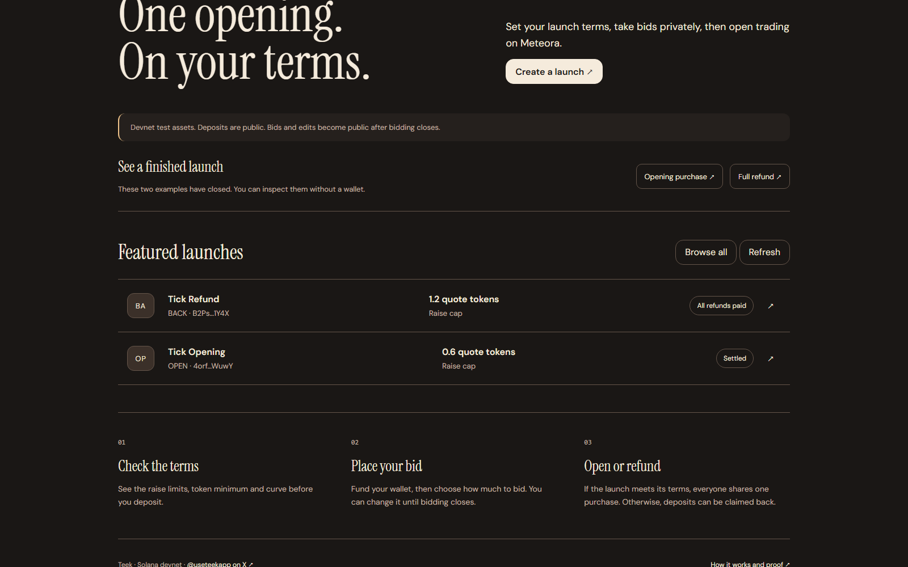

# Teek

Teek is a fairer way to launch a new token on Solana.

[](https://useteek.xyz/launch.html)

Try it live at [useteek.xyz](https://useteek.xyz). Everything runs on Solana devnet with test money, so nothing you do there costs real funds. Follow along on X at [@useteekapp](https://x.com/useteekapp).

New here? Watch the [60 second film](https://drive.google.com/file/d/1SteukTND5wlHnbGc_e6WA0dRNSmsmta9/view) first. It shows the whole idea with no jargon.

## The problem Teek fixes

When a new token launches today, it usually goes on sale the moment it exists. Bots watch for new tokens and buy in the very first second, before any human can react. They get the cheapest price, then sell to everyone who arrived a few seconds later. Regular buyers end up paying more for the same token, mostly because they were slower.

## How Teek works, in plain words

Think of it like a sealed group order.

1. A creator sets the rules before anything starts. That means the token's details, the smallest amount the launch must raise to go ahead, the most it will accept, and the dates for each step. Once published, these rules cannot be changed.
2. People who want in send test funds into a locked account (called an escrow) that belongs to the launch, not to the creator.
3. During the bidding window, each person decides how much of their funds to actually spend. That bid is private. It lives inside MagicBlock's private rollup, which runs on secure hardware, so other bidders and the creator cannot read it while bidding is open.
4. When bidding closes, Teek adds up the bids. If the total is below the minimum, nobody loses anything and everyone gets a full refund.
5. If the minimum is met, one single transaction creates the token's trading pool on Meteora and buys the opening supply with everyone's money at once. Because it is one combined purchase, every buyer pays the same average price. There is no "first second" for a bot to win, since the pool does not exist until that transaction runs.
6. Each buyer then claims their share of tokens plus any unspent funds. A random number from MagicBlock's VRF (a verifiable random number service) settles tiny rounding leftovers fairly. Breaking one bid into several small ones doesn't raise what you expect to get.
7. After that, the token trades normally on Meteora.

## What you can do on the site

The home page explains the idea. The launch app at [/launch.html](https://useteek.xyz/launch.html) lists launches, lets you join one, and lets you create your own with a step by step builder.

To use your own wallet, press "Connect wallet" and pick Phantom, Solflare, Backpack or any other Solana wallet you have installed. Set it to devnet first so its previews match what you sign. If you have no wallet, click "Use demo wallet". The site makes a throwaway wallet that lives only in your browser. Then press "Get test funds" inside a launch and you receive 0.1 test SOL plus 100 test tokens, enough to take part. A wallet that already holds the test funds won't get more, which keeps the shared budget available for others.

Every launch has a Passport page. It shows the launch's rules in plain language, who controls what, how fees are split, and the final result, including which refunds have been paid and which are still waiting to be claimed. You can share it as a card or download it as a file.

The evidence page at [/evidence.html](https://useteek.xyz/evidence.html) shows the real devnet launches we ran as proof. One raised enough, opened its pool and paid everyone out. The other missed its minimum and refunded everyone in full, without ever creating a pool.

The simulator at [/market.html](https://useteek.xyz/market.html) is where Teek started. It shows a speed bot making money on a normal exchange and losing that edge once orders are grouped and priced together. Its live devnet buttons are switched off on the public site, because they need funded test accounts on one shared market, but they work when you run the site on your own computer.

## What Teek does not do yet

We would rather you hear the limits from us.

Funding the escrow is a public transaction, so anyone can see how much each wallet put in. Only the bid itself is hidden, and only while bidding is open. After bidding closes, bids and earlier edits become visible.

A launch can have at most 24 bidders right now. This is a prototype limit.

Everyone shares one purchase on a fixed price curve. It is not an auction where each person names their own maximum price.

It runs on devnet only. The code had a development review, not a formal security audit, so it is not ready for real money.

## Where Teek came from

Teek started in September 2026 as a project called Tick, built for MagicBlock's Solana Blitz v8 hackathon and never submitted. Tick was the batch market you can still see in the simulator. In October we turned that idea into the launch product described above and renamed it Teek. The git history keeps the September version as its first commit so you can see exactly what was added later.

## How the code is organised

Each main folder has its own short README.

- [programs/teek](programs/teek) is the on-chain program, written in Rust with Anchor. It holds the money rules.
- [clients](clients) is shared TypeScript that talks to the program. The website, tests and scripts all use it.
- [teek](teek) is the website, built with Vite and TypeScript, plus project documents and evidence.
- [api](api) is the hosted test-funds service the website calls.
- [tests](tests) checks the program and the full launch flow.
- [scripts](scripts) holds tools for running demos, testing and upgrades.

- [film](film) is the 60 second launch film, built in code with Remotion.
- [docs](docs) holds the brand notes and the older planning documents, including the long technical overview from early October.

## Running it on your own computer

You need Node.js 22 and npm. Building the Solana program also needs Rust, the Solana tools and Anchor, which we run inside WSL on Windows.

Install the packages in the root folder and in the website folder.

```bash
npm install
npm install --prefix teek
```

Start the website, then open the address it prints.

```bash
npm run dev --prefix teek
```

Run the website tests and checks.

```bash
cd teek
npx vitest run
npx tsc --noEmit
npm run build
```

Run the program's own tests (needs Rust).

```bash
cargo test -p teek
```

Build the program the same way the deployed version was built.

```bash
cd programs/teek
cargo build-sbf --tools-version v1.57
```

The longer local and devnet test runs are described in [tests/README.md](tests/README.md).

## Key addresses on devnet

The Teek program lives at `B6eqSCBhokuZLKqBrzwhquUho183P3Fvu8pgC4a9PFkY`. The bytes on chain match a build of this repository exactly, and the record is in [teek/evidence/rename-upgrade-devnet.json](teek/evidence/rename-upgrade-devnet.json).

The successful demo launch is `4orftfqsHc92GJVrFSuvqZKab3LsL4txyNm7BjUYWuwY` and the refunded one is `B2PstiXkcw81SDafJrzQ8eB4YbcG3eYS33hH1Jjq1Y4X`.

The test token the faucet hands out is `GR5J9vsRr4WauZMaj6NvqYJHxRQjVjzcsTuwv2LgADPj`. It has no value.

## Built with

MagicBlock's private rollup and VRF for private bidding and fair randomness, Meteora's Dynamic Bonding Curve for the token pool, and Solana for everything else.

## License and security

Teek is open source under the [MIT License](LICENSE). It runs on devnet only and hasn't had a professional audit yet. If you find a security problem, [SECURITY.md](SECURITY.md) explains how to tell us privately.
