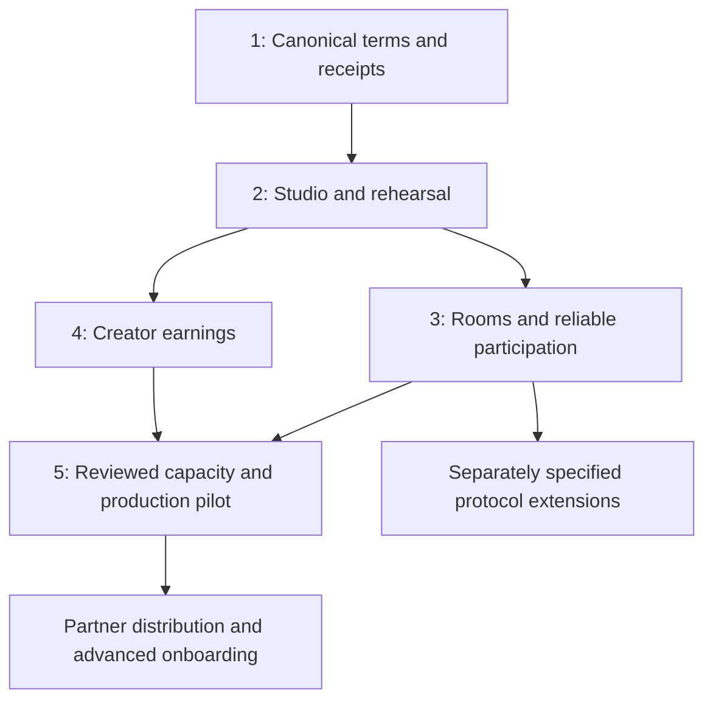

# Teek implementation roadmap

Prepared 2026-10-08 against the current repository and the two feature proposals.
This distinguishes shipped increments from remaining implementation.
Order is based on dependencies and usable releases, not a hackathon deadline.

## Implementation update — 2026-10-08

The first Passport/receipt increment and initial three-step Studio are implemented.
See `PASSPORT_RELEASE.md` for verification and limits. This does not mean all
five milestones or their completion checks are satisfied.

| Area | Status |
|---|---|
| R1 | Typed confirmed read model built; consistent observed-slot/finality reporting remains |
| R2–R4 | SDK configuration decoding, terms Passport, success claims and explicit refund-history verification built |
| R5 | Receipt link, JSON and SVG card built; crawler/social preview endpoint remains |
| R6 | Timestamped confirmed snapshots and explicit errors built; finalized observations remain |
| S1 | Three-step wizard, browser drafts and validation built; no new publish transaction submitted during this review |
| S3–S4 | Restricted creator curve controls and separate DBC configuration transaction connected to Studio; a fresh custom config and Teek launch were confirmed and read back on devnet through the shared helpers. Browser-wallet signing still needs a live check. Fee/LP/recipient terms and total supply shown; complete distribution preview remains |
| S5 | Output floor/config hash included in hashed manifest; durable publication/retrieval remains |
| S6–S8 | Draft/config checked again before initialization; exact aggregate first-purchase rehearsal built from SDK quotes. Custom config rent shown; saved configuration signer and launch PDA support retries. Real devnet retry recovered the existing launch without another spend. Total transaction estimates, browser signing verification and individual allocation examples remain |

Next dependency order: supported configuration factory and durable metadata →
exact rehearsal and transaction estimates → resumable publication/participation →
community room and keeper → creator fees/migration dashboard.

## Product to deliver

Launch Studio → Rehearsal → Community Room → Funding → Private Bidding →
Settlement or Refund → Shareable Receipt → Creator Dashboard.

Initial customer hypothesis: creators with an existing audience and an upcoming
token launch. Validate this with real creators alongside implementation. A new
token-creation interface alone does not supply a community.

Keep the approved Orbit mark and charcoal/ivory/coral identity throughout. Use
the landing page's visual quality while prioritising readable terms on money
screens. Retain the existing Vite/TypeScript client and Anchor program; these
features do not justify a framework or Solana SDK migration.

## Existing foundation and remaining gaps

| Capability | Existing evidence | Work remaining |
|---|---|---|
| Private budget edits | Hosted Private ER account/transaction checks | Broader privacy surfaces, session UX and outage recovery |
| Escrow and launch terms | Solana program and client | Readable Passport and supported configuration workflow |
| Proportional allocation | VRF-dependent rounding and settlement tests | Exact rehearsal scenarios and larger-capacity design |
| DBC opening | Atomic pool creation, pooled first buy, creator-rights transfer | Creator-facing configuration and fee claims |
| Claims/refunds | Recorded devnet success and failed-minimum outcomes | Clear progress, retry/resume and paid-versus-available receipts |
| Creator fees | Demo config includes a creator fee share | User-selected supported terms, fee breakdown and claim UI |
| Public demo | Frontend build and Vercel/faucet source exist | Verify deployment, remote onboarding and current config; code alone is not proof of a working hosted demo |
| Scale | Actual 24-wallet settlement tested | Beyond 24 wallets requires protocol design, not a constant bump |
| DAMM v2 migration | Supported by configured DBC integration | Real graduation/migration and rights verification not yet demonstrated |

Authoritative baseline: `SETTLEMENT_SPEC.md`, `PRIVATE_BIDS.md`,
`LAUNCH_DEMO.md`, `SETTLEMENT_REVIEW.md` and public evidence JSON.

## Milestone 1 — Public terms and verifiable receipts

**Outcome:** anyone can understand a launch before participation and verify its
observed outcome afterward. Build this first because every later screen should
use the same facts.

- [ ] R1. Create a typed launch read model: network, program, launch/config/mint
  addresses, metadata, timing, minimum/cap, minimum output, authority powers,
  fee/LP policy, status, observed slot and data freshness.
- [x] R2. Decode DBC configuration through supported SDK/IDL types where
  available. Keep program ABI pinning and existing ABI tests; avoid spreading
  unexplained byte offsets across new UI components.
- [x] R3. Build the pre-opening Passport. Distinguish protocol-enforced terms,
  off-chain creator statements and unavailable data. Display public funding,
  window-only bid confidentiality, post-close edit disclosure, creator veto,
  wallet capacity and recovery limitations.
- [x] R4. Build success and refund receipts, including participating wallets,
  actual quote spent, actual tokens received and shared average opening price.
  Derive successful claim completion from the claim bitmap. For failed-launch
  refunds, establish original liabilities and actual withdrawals from verified
  transaction history/events; current balances alone cannot prove amounts paid.
- [ ] R5. Provide stable public receipt URLs, JSON export and an image card.
  Include network and observation time on shared cards. Social previews need
  server-rendered metadata or a preview endpoint, not only client-rendered HTML.
- [ ] R6. Label confirmed transactions separately from finalized observations;
  show an RPC failure as unavailable/stale, never as a fabricated zero balance.

**Completion checks:** reproduce both recorded outcomes from authoritative data;
pending claims are not reported as paid; copied URLs work without a wallet;
shared images match their source receipt; malformed and missing accounts show
clear errors. Financial calculations preserve base units.

**Likely files:** extend `clients/launch.ts`, `teek/src/launch-ui.ts`,
`teek/src/launch-page.ts`, `teek/src/evidence-page.ts`; add proposed
`clients/launch-read.ts`, `teek/src/launch-passport.ts`, `teek/src/launch-receipt.ts`
and a public receipt entry if a separate route is needed.

**Protocol change:** none intended. Receipt history availability must be solved
without pretending current account state contains every past payment.

## Milestone 2 — Launch Studio, supported economics and rehearsal

**Outcome:** a creator can prepare and publish correct terms without manually
finding quote-mint/config addresses. Depends on R1–R3.

- [x] S1. Split creation into Identity → Economics → Review. Save a versioned
  local draft and support resuming it. Validate names, symbols, byte lengths,
  dates, token precision and totals before asking for signatures.
- [ ] S2. Add image/metadata upload with size/type checks and durable,
  content-addressed metadata. Never imply that an immutable metadata URI makes
  the contents of an arbitrary mutable website immutable.
- [ ] S3. Build a supported DBC config factory starting from
  `clients/dbc-config.ts`. Use versioned presets and an advanced preview. Stay
  within Teek's pinned supported SPL/fee/migration profile; do not expose every
  current Meteora SDK option automatically.
- [ ] S4. Show supply distribution, creator/partner fees, leftover receiver,
  liquidity ownership/locks and migration conditions. Clearly separate creator
  trading-fee share from the LP/fee arrangement after migration. Do not infer
  a post-migration creator share from a pre-migration percentage.
- [ ] S5. Generate and store a canonical versioned manifest including all
  reviewable inputs and the output floor. Compare it to chain fields and the
  separate complete-config hash. Off-chain storage is explanatory evidence;
  on-chain validation remains authoritative.
- [ ] S6. Estimate actual creation rent/fees and describe the signing sequence.
  Simulate supported transactions. Preserve existing atomic launch initialization
  plus settlement binding; if config creation is separate, persist its receipt
  and resume it safely instead of creating another config on retry.
- [ ] S7. Add rehearsal scenarios: below minimum, normal opening, oversubscription,
  output-floor failure, cancellation/expiry and rounding at token precision.
  Use exact curve quotes and program arithmetic. Never use floating-point values
  as settlement inputs or the old CLOB simulator as a launch calculator.
- [ ] S8. Show personal accepted-budget/token examples as hypothetical.
  Before a VRF seed exists, show supported allocation bounds/expectations rather
  than a guaranteed individual rounded allocation. Rehearsal reads public
  configuration and user-entered scenarios, not sealed live demand.

**Completion checks:** a fresh creator publishes a supported devnet launch using
the wizard; its chain/config fields reproduce the accepted preview; equivalent
scenario fixtures match real program settlement, including fees, rounding and
rollback; retry does not publish duplicate launches; unavailable estimates stop
the flow with an explanation. A real creator can explain their terms unaided.

**Likely files:** extend `clients/dbc-config.ts`, `clients/launch.ts` and
`teek/src/launch-page.ts`; add proposed draft, manifest, config-policy and
rehearsal modules. Add durable metadata storage and upload endpoints only with
the chosen provider's explicit storage/retention policy.

**Protocol change:** avoid widening config acceptance initially. Any newly
accepted config profile needs corresponding integration tests and review.

## Milestone 3 — Community rooms and reliable participation

**Outcome:** a creator shares one mobile URL and supporters finish the real
funding/bidding/claim lifecycle. Depends on the first two milestones.

- [ ] C1. Build a branded launch room with identity, creator story, fixed terms,
  countdown, personal participation timeline and recorded/current outcome states.
  Use no private demand totals or inferred bid competitiveness.
- [ ] C2. Add wallet onboarding and a visible signing sequence. Present funding
  and bidding as distinct phases. Do not default to spending all deposited funds
  or require valuable-wallet key import for the demo.
- [ ] C3. Make the transaction flow resumable: registered, delegated,
  authenticated, privacy activated, bid saved, returned, claimable and claimed.
  Read confirmed state before retrying. Handle rejected signatures, expired
  sessions, stale blockhashes and refresh/reopen without duplicate deposits.
- [ ] C4. Add an operator/keeper for legal post-close actions: return delegated
  bids, verify L1 ownership, close, request randomness, wait for callback and
  settle or expire. Reuse supported permissionless paths and fixed destinations;
  the worker's payer must not gain custody or authority to edit private bids.
- [ ] C5. Provide claim/refund reminders and clear pending recovery states.
  Initial release retains owner-authorized claims. Third-party pushed payments
  are a separate program capability, not a frontend switch.
- [ ] C6. Add signed creator updates separate from immutable launch terms.
  Maintain access checks, abuse handling and a clear distinction between posts
  and contract-enforced promises.
- [ ] C7. Add opt-in notifications. Start with one channel, e.g. Telegram alerts
  that link back to the room. Account linking and consent must be verified;
  never store private RPC session credentials in public links or logs.
- [ ] C8. Verify the hosted devnet faucet and remote participation path using
  dedicated test assets, bounded funding and rate limits. Existing `api/fund.ts`
  is a starting point; it is not authorization for mainnet sponsorship.

**Completion checks:** two fresh external wallets complete a new success case;
another launch completes failure/refund; unauthorized private reads are denied;
reload/session expiry recover; a creator can leave and supported automated close
still completes; outages show truthful pending states rather than fake success.

**Likely files:** split the existing launch page into proposed studio/room/
participation components; extend `clients/launch.ts`; add a keeper under
`scripts/`, signed-update storage and a consent-based notification worker.

**Protocol change:** none intended for the first worker. Verify access rules of
each instruction before advertising a fully autonomous lifecycle.

## Milestone 4 — Creator earnings and launch operations

**Outcome:** creators can understand and claim the rights their chosen config
actually grants, and monitor the launch after opening. Depends on supported
config creation and a settled pool.

- [ ] E1. Add a creator dashboard listing their launches, pool state, claimable
  fees, completed fee claims and relevant token/liquidity unlocks.
- [ ] E2. Use native DBC fee read/claim instructions where possible. Validate
  creator and partner recipients against the fixed config and recorded pool
  creator. Partner payment configuration must be explicit, not a demo wallet.
- [ ] E3. Exercise a small devnet trade/fee claim after opening and verify
  receiver balances and transaction receipts. Correctly label phase-specific
  fees, pool reserves and amounts that are not yet claimable.
- [ ] E4. Demonstrate graduation into DAMM v2 using a purpose-built test config.
  Verify migrated pool, LP locks/rights and applicable post-migration fee claims.
  Do not reuse the existing non-graduating demo as proof of migration.
- [ ] E5. Add actual-chain migration/unlock alerts and creator update tools.
  Do not claim total lifetime earnings unless available history supports it.

**Completion checks:** configured creator earns and claims demonstrable fees;
unauthorized wallets cannot claim; migration rights match published terms;
dashboard amounts reconcile with chain receipts before/after claims.

**Likely files:** proposed `clients/creator-fees.ts`, creator dashboard page and
read-only pool index. Continue native Meteora integration rather than inventing
a second fee-custody contract for ordinary claims.

## Milestone 5 — Capacity, production and distribution

**Outcome:** a reviewed, recoverable product can support a larger pilot and be
integrated by a partner. Reliability work starts alongside earlier milestones;
completion is required before real-value launch.

- [ ] P1. Produce a capacity design for a specific pilot size agreed with a
  real creator/operator. The current fixed registry, arrays, full-account
  snapshot, instruction size, compute use and u32 claim bitmap limit scale.
  Do not raise `MAX_LAUNCH_BIDDERS` alone. Evaluate paged accounts, committed
  aggregate snapshots and scalable claims while preserving conservation,
  complete input validation and random rounding semantics.
- [ ] P2. Benchmark registration, private edits, returns, close, allocation and
  claims at the chosen capacity. Design new account versions and preserve old
  launches' settlement/refund paths. UI-only replication across 24-wallet rooms
  is not a single fairly allocated large launch.
- [ ] P3. Broaden privacy testing to subscriptions, enumeration, transaction
  histories and provider observability. Document TEE assumptions and recovery;
  do not invent a guarantee of recovery from an unavailable ER.
- [ ] P4. Make network config explicit; separate devnet/mainnet addresses,
  endpoints, assets and explorer links. Protect secrets server-side, bound
  worker/sponsor budgets, provide logs without credentials and alert on stalled
  launches. Reduce heavy frontend bundles and unnecessary RPC scans.
- [ ] P5. Complete threat review, real-program integration/adversarial tests and
  at least one independent review for changed DeFi deployments. Before mainnet,
  require external audit, upgrade/custody authority policy, outage runbook and
  a separate deployment decision. The earlier review does not cover new code.
- [ ] P6. Publish and exercise a small typed partner client plus embed example.
  Build a Blink funding adapter only after registration/delegation can resume
  correctly; some clients require a website fallback and private bidding stays
  in the authenticated room unless fully demonstrated otherwise.
- [ ] P7. Add embedded-wallet/passkey onboarding only after verifying message,
  transaction and versioned-transaction signing requirements with Private ER.
  Sponsored fees require restricted transaction policies and explicit budgets.
  Neither feature silently permits agent spending from a user's wallet.
- [ ] P8. Run a bounded, reviewed pilot, then document real customer feedback,
  observed completion rates and operator demand. Record genuine interviews;
  publish only consented claims and verified traction.

**Completion checks:** chosen capacity is demonstrated, invariants and legacy
recovery hold, independent review findings are resolved, public flows work from
a second device, authority/recovery policy is documented, one partner completes
the integration example and pilot figures reconcile with recorded evidence.

## Later protocol extensions — spec before implementation

| Extension | Required design | Entry condition |
|---|---|---|
| Community-first allocation | Eligibility proof, pool proportions, snapshot time, precedence, privacy and proportional rounding; per-wallet limits are not personhood | Customer demand plus tested core launch journey |
| Team/contributor commitments | Supply source, native vesting suitability, recipients, claims, fee-share immutability and powers | Supported config and creator fee/migration paths demonstrated |
| Third-party pushed refunds | Permissionless execution to owner-fixed destinations, ATA/rent payer, replay protection, bounded batches, outage behavior | Explicit reviewed program support; current owner claims retained |
| Sealed opening hour | Inventory, custody, transferability, DBC activation/public pool timing, batch clearing, outside markets and handoff | Standalone mechanism feasibility proof; reuse of old engine is not sufficient |
| Project operating treasury | Separate proceeds and inventory economics, spending authority and real-world milestone resolution | Treat as a different sale architecture; never divert existing liquidity-opening funds |
| Agent launches/bids | Signed intents, delegated limits, expiry/revocation, spend ceilings and private session isolation | Stable typed client and proven end-user participation |

## Dependency and release map

Each milestone is split into the task IDs above. Implement one bounded slice,
verify it, then proceed. Do not label a whole milestone complete because one
screen renders. Initial devnet releases can retain the disclosed 24-wallet cap;
capacity design begins early, and mass-launch promotion waits for the result.

## Quality and submission work running alongside the roadmap

- Preserve exact amounts, network labels, public/private boundaries and distinct
  available-versus-paid outcomes across landing, studio, room, receipt and docs.
- Test critical signing/recovery paths and money arithmetic; check relevant
  screen sizes, keyboard operation, accessible labels and reduced motion.
- Keep the success/refund demo, add wizard/rehearsal and actual creator-fee proof
  as those ship. Update scripts and claims to the final implemented product.
- Recheck complete current event/sponsor rules before submission. This document
  adds no eligibility certification: MagicBlock privacy and Meteora opening are
  central; mainnet-data sponsor tracks need their actual qualifying integration.
- Maintain honest prior-work disclosure, public repo accessibility, team facts,
  customer evidence, demo hosting and required videos. No invented traction.

## First implementation slice

Start R1–R4: canonical launch facts, Passport and receipts for the existing
success/refund examples. Solve failed-refund payment history explicitly. Then
add sharing/export and move into the config-backed Studio. This is the smallest
useful improvement and establishes the data contract for later screens.

## References

- Local baseline: `clients/launch.ts`, `clients/dbc-config.ts`,
  `programs/teek/src/{launch,launch_settlement,launch_allocation,dbc_wire}.rs`,
  `teek/src/launch-page.ts` and `teek/src/launch-ui.ts` (paths relative to repo
  root except this document's links).
- [Settlement spec](../../teek/SETTLEMENT_SPEC.md), [private bids](../../teek/PRIVATE_BIDS.md),
  [demo guide](../../teek/LAUNCH_DEMO.md), [quality review](QUALITY_REVIEW.md).
- [Official Meteora DBC source and configuration](https://github.com/MeteoraAg/dynamic-bonding-curve/blob/main/README.md).
- [Official Solana Actions and Blinks specification](https://solana.com/docs/tools/actions).

Official docs establish capabilities, not Teek compatibility with every option.
Implementation must continue to respect the SDK/ABI pin and current program
validation until new behavior has been tested and reviewed.
