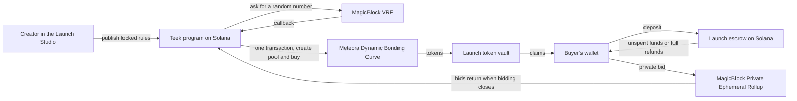

# How Teek fits together

## Step by step

1. The creator publishes a launch. The program stores the rules and a hash of the exact Meteora curve config, so neither can change later.
2. Buyers deposit into an escrow owned by the launch. This is a normal public Solana transaction.
3. Each buyer's bid account is handed to MagicBlock's Private Ephemeral Rollup, running on a TEE validator, with a permission that lets only that buyer read or edit it.
4. Bids can be changed until bidding closes. Then the permission is removed and every bid is committed back to Solana.
5. The program counts the bids. If they're under the minimum, the launch switches to refunds. Otherwise it records the accepted total, capped at the maximum.
6. The program asks MagicBlock VRF for a random number, which the oracle sends back in a callback. It's used to share out the leftover token units fairly.
7. One transaction checks the curve config, creates the Meteora pool and buys from it with the accepted money. The tokens go into a vault owned by the launch.
8. Each buyer claims their exact share of tokens plus any unspent deposit. If the launch failed, was cancelled or ran past its deadline, they claim a full refund instead.

## Why it needs MagicBlock

Without the private rollup, every bid would be readable on Solana the moment it was placed, and buyers could watch and react to each other. The rollup keeps bids private while it matters and then hands them back to Solana to settle. VRF gives a random number nobody can choose in advance, which keeps the leftover sharing fair.
